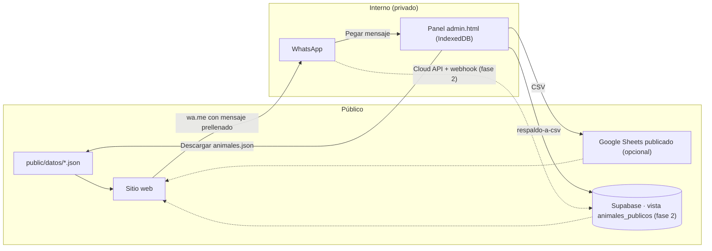
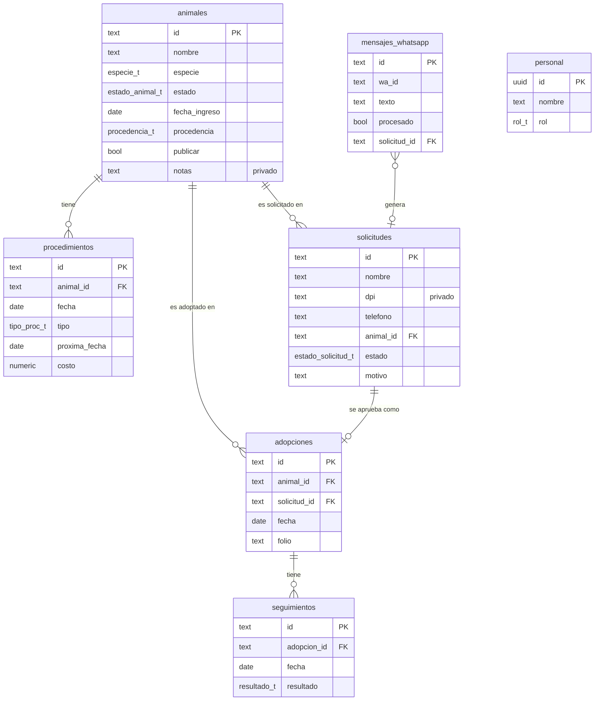
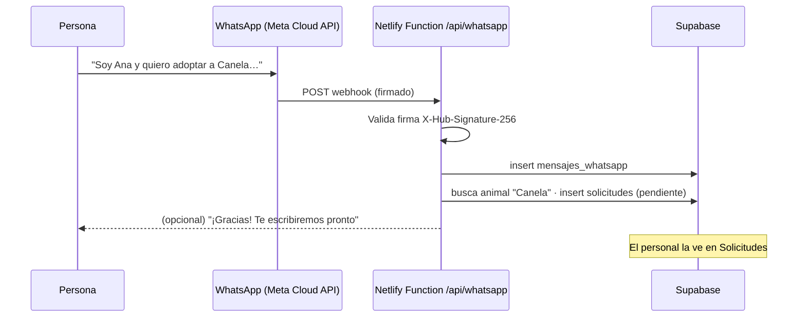

# README técnico — Albergue Municipal de Mascotas Mixco

Documento para quien instale, publique o mantenga el proyecto. La guía para el personal está en [GUIA_DE_USUARIO.md](GUIA_DE_USUARIO.md).

**Contenido**
1. [Resumen y stack](#1-resumen-y-stack)
2. [Instalación y comandos](#2-instalación-y-comandos)
3. [Estructura del proyecto](#3-estructura-del-proyecto)
4. [Cómo fluyen los datos](#4-cómo-fluyen-los-datos)
5. [Formato de los datos de la página](#5-formato-de-los-datos-de-la-página)
6. [Publicar el sitio](#6-publicar-el-sitio)
7. [Google Sheets como fuente de datos](#7-google-sheets-como-fuente-de-datos)
8. [Panel de gestión](#8-panel-de-gestión)
9. [Propuesta de base de datos (Supabase / PostgreSQL)](#9-propuesta-de-base-de-datos-supabase--postgresql)
10. [Conectar el WhatsApp del albergue](#10-conectar-el-whatsapp-del-albergue)
11. [Seguridad y privacidad](#11-seguridad-y-privacidad)
12. [Mantenimiento y pruebas](#12-mantenimiento-y-pruebas)

---

## 1. Resumen y stack

| | |
|---|---|
| Framework | React 18 + Vite 5 (sin backend) |
| Páginas | `index.html` (sitio público) y `admin.html` (panel de gestión) |
| Datos del sitio | JSON en `public/datos/` → opcionalmente Google Sheets o Supabase |
| Datos del panel | IndexedDB del navegador (local) → propuesta: Supabase |
| Dependencias de ejecución | Solo `react` y `react-dom` |
| Hosting | Cualquier hosting estático (Netlify, GitHub Pages, Vercel, servidor de la Municipalidad) |
| Costo | Q0 con planes gratuitos |

Decisiones de diseño (alineadas con el análisis ético del proyecto):
- **Sostenible:** sin servidor ni base de datos obligatoria; el albergue solo edita datos.
- **Seguro en donaciones:** el sitio no procesa pagos; muestra cuentas o un enlace a una pasarela verificada.
- **Privacidad:** los formularios no envían nada a servidores; los datos personales viven solo en el panel.

## 2. Instalación y comandos

Requisito: Node.js 18 o superior.

```bash
npm install
```

| Comando | Qué hace |
|---|---|
| `npm run dev` | Servidor local: sitio en `http://localhost:5173`, panel en `/admin.html` |
| `npm run verificar` | Valida `public/datos/*.json`: errores (✗) y datos de ejemplo pendientes (⚠). Termina con código 1 si hay errores |
| `npm run build` | Ejecuta `verificar` y genera `dist/` (falla si hay errores en los datos) |
| `npm run preview` | Sirve `dist/` para probar la versión compilada |
| `npm run plantillas` | Regenera `plantillas/google-sheets/*.csv` desde los JSON actuales |
| `npm run respaldo-a-csv -- archivo.json` | Convierte un respaldo del panel en CSV para importar a Supabase |
| `npm run docs:pdf` | Regenera los PDF de `docs/pdf/` desde los `.md` (requiere Edge o Chrome e internet) |

## 3. Estructura del proyecto

```
albergue-mixco/
├─ index.html · admin.html          Entradas de Vite (sitio y panel)
├─ public/
│  ├─ datos/                        ← LO QUE EDITA EL ALBERGUE
│  │  ├─ albergue.json              Información general, contacto, sede, adopción, donaciones
│  │  ├─ animales.json              Animales publicados
│  │  ├─ publicaciones.json         Avisos, diario, necesidades
│  │  └─ config.json                Fuentes externas opcionales (Sheets / Supabase)
│  └─ fotos/                        Imágenes
├─ src/
│  ├─ App.jsx · main.jsx            Sitio público
│  ├─ components/                   Una sección por archivo (Hero, Animales, Donaciones…)
│  ├─ utils.js                      Carga de datos (JSON → Sheets → Supabase), fechas, WhatsApp
│  ├─ hojas.js                      CSV ⇄ objetos (compartido por sitio, panel y scripts)
│  ├─ useRuta.js                    Rutas #/peludito/<id>
│  ├─ styles.css                    Estilos; colores en :root
│  └─ admin/                        Panel de gestión
│     ├─ db.js                      IndexedDB (único archivo a cambiar para usar Supabase)
│     ├─ esquemas.js                Campos y tablas del panel
│     ├─ logica.js                  Tablero, exportaciones, lector de mensajes de WhatsApp
│     ├─ Panel.jsx · Tabla.jsx      Interfaz
│     └─ ejemplo.js                 Datos ficticios de capacitación
├─ scripts/                         verificar · plantillas · respaldo-a-csv · generar-pdf
├─ plantillas/google-sheets/        CSV para importar en Google Sheets
└─ docs/
   ├─ ENTREGA.md                    Acta de entrega
   ├─ GUIA_DE_USUARIO.md
   ├─ README_TECNICO.md             (este archivo)
   ├─ base-de-datos/esquema.sql     Propuesta de base de datos
   ├─ whatsapp/whatsapp-webhook.mjs Propuesta de integración con WhatsApp Cloud API
   └─ pdf/                          Versiones PDF de la documentación
```

## 4. Cómo fluyen los datos



Orden de prioridad al cargar el sitio (`src/utils.js → cargarDatos`):
1. Lee los 4 JSON (siempre; son el respaldo).
2. Si `config.supabase.url` y `anonKey` están llenos → reemplaza `animales` con la vista `animales_publicos`.
3. Para cada enlace en `config.googleSheets` → reemplaza esa lista con la hoja.
4. Si una fuente externa falla, se queda con el JSON y avisa en la consola.

Los JSON se piden con `?v=timestamp`, así que los cambios se ven sin limpiar caché.

## 5. Formato de los datos de la página

La guía de usuario explica cada campo con ejemplos. Resumen de valores controlados (los valida `npm run verificar`):

| Archivo → campo | Valores |
|---|---|
| `albergue.contacto.whatsapp` | `502` + 8 dígitos (`^502\d{8}$`) |
| `albergue.redes[].red` | `facebook`, `instagram`, `tiktok`, `youtube`, `x`, `whatsapp` |
| `albergue.adopcion.cuestionario.preguntas[].tipo` | `opciones` (con `opciones: []`) o `texto`; `opcional: true` |
| `animales[].id` | `^[a-z0-9-]+$`, único (es la URL de la ficha) |
| `animales[].especie` / `sexo` / `tamano` / `estado` | `perro·gato` / `macho·hembra` / `pequeño·mediano·grande` / `disponible·en-proceso·adoptado` |
| `animales[].finalFeliz` | `{ fecha, texto, foto }` opcional |
| `publicaciones.anuncios[].tipo` | `adopcion`, `vacunacion`, `esterilizacion`, `campana`, `aviso` |
| Fechas | `AAAA-MM-DD` |
| `publicaciones.necesidades[].prioridad` | `alta`, `media`, `baja` |
| Fotos | Rutas relativas a `public/` (`fotos/x.jpg`) o URL `https://` |

Enlaces que genera el sitio:
- Ficha de un animal: `/#/peludito/<id>` · Aviso: `/#aviso-<id>` · Secciones: `/#peluditos`, `/#donar`, `/#sede`, etc.
- WhatsApp: `https://wa.me/<whatsapp>?text=<mensaje>` (todos los botones usan `albergue.contacto.whatsapp`).

## 6. Publicar el sitio

`vite.config.js` usa `base: './'`, así que `dist/` funciona en cualquier carpeta o dominio.

**Opción A — Netlify + GitHub (recomendada, gratis, el albergue edita desde el navegador)**
1. Subir el proyecto a un repositorio de GitHub (puede ser de la Municipalidad).
2. En Netlify: *Add new site → Import from Git* → elegir el repositorio.
   Build command: `npm run build` · Publish directory: `dist`.
3. Cada vez que alguien edite un JSON en GitHub (lápiz ✏️ → *Commit*), Netlify publica solo. Si los datos tienen un error, **el build falla y el sitio anterior sigue en línea** (gracias a `prebuild: verificar`).
4. Dominio propio (opcional): *Domain settings → Add custom domain*.

**Opción B — Netlify Drop (sin GitHub):** `npm run build` y arrastrar `dist/` a https://app.netlify.com/drop. Para cambiar datos después: editar `dist/datos/*.json` y volver a arrastrar.

**Opción C — Servidor de la Municipalidad:** copiar el contenido de `dist/` a cualquier carpeta pública del servidor web (Apache, Nginx, IIS). No requiere PHP ni base de datos.

> `admin.html` se publica junto al sitio. Es seguro: cada navegador ve su propia base local (vacía para el público) y la página tiene `noindex`.

## 7. Google Sheets como fuente de datos

Permite que el personal edite **animales, anuncios, actividades y necesidades** en una hoja, sin publicar de nuevo.

1. `npm run plantillas` (ya están generadas en `plantillas/google-sheets/`).
2. En Google Sheets: crear un documento → una pestaña por archivo (`animales`, `anuncios`, `actividades`, `necesidades`) → *Archivo → Importar → Subir* → “Reemplazar hoja actual”.
3. *Archivo → Compartir → Publicar en la web* → elegir la pestaña → formato **Valores separados por comas (.csv)** → Publicar → copiar el enlace (termina en `output=csv`).
4. Pegar cada enlace en `public/datos/config.json → googleSheets`.

Conversión de columnas (`src/hojas.js`): listas separadas por coma; casillas `sí/no/x/true/1`; fechas `AAAA-MM-DD` o `DD/MM/AAAA`; en animales, `vacunas`, `desparasitado`, `esterilizado` y `finalFelizFecha/Texto/Foto` son columnas planas. Google tarda unos minutos en refrescar el CSV publicado.

## 8. Panel de gestión

- **Almacenamiento:** IndexedDB `albergue-mixco-gestion` (versión 1) con los almacenes `animales`, `procedimientos`, `solicitudes`, `adopciones`, `seguimientos`. Llama a `navigator.storage.persist()` para que el navegador no lo borre por falta de espacio.
- **Ids:** los animales usan un *slug* del nombre (`canela`, `canela-2`) para que coincida con la URL pública; el resto usa `crypto.randomUUID()`.
- **Reglas:** guardar una adopción cambia el animal a `adoptado` y la solicitud a `aprobada`; no se puede eliminar un registro con relaciones.
- **Tablero:** próximas dosis (último procedimiento por animal+tipo con `proximaFecha` ≤ hoy+14, solo animales en el albergue), seguimientos a 30 y 180 días, solicitudes pendientes, adopciones de los últimos 6 meses.
- **Agregar un campo:** una línea en `src/admin/esquemas.js` (`{ k, l, t, op?, ref? }`). Tipos: `texto`, `area`, `fecha`, `numero`, `opciones`, `casilla`, `color`, `colorOpcional`, `etiquetas`, `ref`. El formulario, la búsqueda y la exportación a Excel lo toman solos. Si también debe ir a la base de datos, agregar la columna en `esquema.sql` y en `scripts/respaldo-a-csv.mjs`.
- **Respaldo:** JSON `{ app: 'albergue-mixco-gestion', version, fecha, datos: { tabla: [...] } }`.
- **Importar desde WhatsApp:** `leerMensajeWhatsapp()` en `logica.js` reconoce los mensajes que genera el sitio (cuestionario y botón “Quiero adoptar a…”), incluida la marca de hora `[fecha] Nombre:` que agrega WhatsApp al copiar.

## 9. Propuesta de base de datos (Supabase / PostgreSQL)

**Cuándo dar este paso:** cuando varias personas necesiten usar el panel desde distintos equipos o se quiera recibir WhatsApp automáticamente. **Requiere un acuerdo formal de manejo de datos personales con la Municipalidad.** Mientras tanto, el panel local cubre la necesidad sin riesgos de exposición.

**Por qué Supabase:** PostgreSQL real con plan gratuito, inicio de sesión incluido, seguridad por fila (RLS), API REST automática y un *Table editor* parecido a una hoja de cálculo que el personal puede usar directamente. El esquema es PostgreSQL estándar: también funciona en un servidor propio de la Municipalidad.

### Modelo de datos



Contenido de [`base-de-datos/esquema.sql`](base-de-datos/esquema.sql):
- **Tablas** iguales al panel (en `snake_case`) + `personal` (usuarios con rol `admin`, `personal` o `veterinario`) + `mensajes_whatsapp`.
- **Tipos enumerados** para estados, especies, procedimientos, etc. (la base rechaza valores inválidos).
- **Disparadores:** fecha `actualizado` automática y la misma regla del panel al registrar una adopción.
- **Vistas:** `animales_publicos` (mismo formato que `animales.json`, sin datos privados, salud calculada), `proximos_procedimientos`, `seguimientos_pendientes`, `informe_mensual` (ingresos, adopciones, esterilizaciones y solicitudes de los últimos 12 meses).
- **Seguridad (RLS):** el público (`anon`) solo puede leer `animales_publicos`; el personal activo lee y edita todo; solo `admin` elimina.

### Pasos para crearla
1. Crear una cuenta y un proyecto en https://supabase.com (región más cercana: *East US*).
2. *SQL Editor → New query* → pegar `docs/base-de-datos/esquema.sql` → **Run**.
3. *Authentication → Users → Add user* para el encargado; copiar su UID y ejecutar la última línea del SQL (`insert into personal …`).
4. **Migrar los datos del panel:** descargar un respaldo en el panel y ejecutar
   `npm run respaldo-a-csv -- respaldo-albergue-AAAA-MM-DD.json`. En *Table editor* importar los CSV de `migracion-supabase/` en este orden: animales → procedimientos → solicitudes → adopciones → seguimientos. Después **borrar** esa carpeta.
5. **Conectar el sitio:** en `public/datos/config.json → supabase` poner la *Project URL* y la clave **anon** (*Project Settings → API*). La página leerá los animales de la vista pública. **Nunca** poner la clave `service_role` en el sitio (`npm run verificar` lo detecta).
6. **Conectar el panel (desarrollo pendiente para esa fase):** reemplazar las funciones de `src/admin/db.js` (`todo`, `todos`, `guardar`, `borrar`, `reemplazarTodo`) por llamadas a `@supabase/supabase-js` con inicio de sesión, convirtiendo `camelCase ⇄ snake_case` con el mismo mapa de `scripts/respaldo-a-csv.mjs`. El resto del panel no cambia. Mientras no se haga, el personal puede trabajar directo en el *Table editor* de Supabase y usar las vistas como tablero.

> ✅ Probado: el esquema se ejecutó en PostgreSQL (PGlite), se importó un respaldo completo del panel con `respaldo-a-csv`, y se comprobaron los disparadores, las vistas y que el rol `anon` no puede leer las tablas.

## 10. Conectar el WhatsApp del albergue

Cuatro niveles; los dos primeros **ya funcionan** sin costo ni contrato.

### Nivel 0 — Botones con mensaje prellenado ✅
Todos los botones del sitio abren `wa.me/<número>?text=<mensaje>` con un texto distinto según el botón (adoptar a X, información de un aviso, donar un insumo, voluntariado, comprobante, contacto, cuestionario). **Solo hay que configurar el número** en `albergue.json → contacto.whatsapp` (`502XXXXXXXX`).

### Nivel 1 — De WhatsApp al panel en 3 clics ✅
En el panel: *Solicitudes → Pegar mensaje de WhatsApp*. Reconoce nombre, animal, vivienda y respuestas del cuestionario, y deja la solicitud lista para revisar.

### Nivel 2 — WhatsApp Business (app gratuita, sin código)
Recomendado desde ya:
- **Perfil de empresa:** horario, dirección y enlace a la página.
- **Respuestas rápidas:** por ejemplo `/adoptar` → “¡Gracias! Llena este cuestionario: https://SU-SITIO/#adopcion”, `/donar` → enlace a `#donar`, `/horario` → horario.
- **Etiquetas** con los mismos estados del panel: *Solicitud nueva*, *En revisión*, *Aprobada*, *No aprobada*, *Seguimiento*. Así el chat y el panel hablan el mismo idioma.
- **Mensaje de bienvenida / ausencia** con el enlace a la página.

### Nivel 3 — WhatsApp Cloud API → base de datos (automático, fase 2)
Cada mensaje que llega se guarda en `mensajes_whatsapp` y, si es una solicitud de adopción, se crea sola en `solicitudes` (estado *pendiente*), con respuesta automática opcional.



Implementación propuesta: [`whatsapp/whatsapp-webhook.mjs`](whatsapp/whatsapp-webhook.mjs) (Netlify Function, sin dependencias).

Pasos:
1. Tener la base del punto 9 creada.
2. Crear una cuenta en Meta for Developers → *Create app* (tipo *Business*) → agregar el producto **WhatsApp** y vincular la cuenta de WhatsApp Business del albergue y su número.
3. Copiar `docs/whatsapp/whatsapp-webhook.mjs` a `netlify/functions/whatsapp.mjs` y publicar.
4. En Netlify → *Environment variables*: `WA_VERIFY_TOKEN`, `WA_APP_SECRET`, `SUPABASE_URL`, `SUPABASE_SERVICE_KEY` (y `WA_ACCESS_TOKEN`, `WA_PHONE_NUMBER_ID` si quieren la respuesta automática).
5. En Meta → WhatsApp → *Configuration → Webhook*: URL `https://SU-SITIO/api/whatsapp`, el mismo *verify token*, y suscribirse al campo **messages**.
6. Enviar un mensaje de prueba y revisar la tabla `mensajes_whatsapp`.

Consideraciones:
- **Número:** revisen en la documentación vigente de Meta si el número puede seguir usándose en la app de WhatsApp Business al mismo tiempo (“coexistencia”) o si conviene un número dedicado.
- **Costos:** responder conversaciones que inicia el usuario suele ser gratuito o de bajo costo, pero las tarifas de Meta cambian: confírmenlas en su página de precios antes de activarlo.
- **Seguridad:** la clave `service_role` y el *App secret* viven **solo** en las variables de entorno de Netlify. La función valida la firma de Meta y responde `401` si no coincide.

> ✅ Probado con solicitudes simuladas: verificación del webhook (200 / 403), firma válida o falsa (200 / 401), guardado del mensaje, creación de la solicitud con el animal correcto y mensajes que no son solicitudes guardados sin crear solicitud.

## 11. Seguridad y privacidad

- [ ] El sitio no tiene formularios que envíen datos a un servidor (contacto y cuestionario abren WhatsApp o el correo).
- [ ] Ningún dato personal en `public/`, en hojas publicadas ni en `animales_publicos`.
- [ ] Donaciones solo por cuentas oficiales o un enlace a una pasarela verificada (`enlacePago`).
- [ ] Respaldo semanal del panel, guardado fuera del navegador y sin compartirlo por redes.
- [ ] Clave `service_role` y secretos de Meta solo en variables de entorno del servidor.
- [ ] Fotos solo con autorización; fotos de familias adoptantes solo con su permiso.
- [ ] Acuerdo de manejo de datos con la Municipalidad antes de pasar a Supabase / WhatsApp API.

## 12. Mantenimiento y pruebas

- **Rollup en WebAssembly:** `package.json` tiene `"overrides": { "rollup": "npm:@rollup/wasm-node@^4.27.0" }` porque en algunas computadoras Windows la política de control de aplicaciones bloquea el binario nativo de Rollup. Funciona igual en cualquier sistema; si no hace falta, se puede quitar.
- **Actualizar dependencias:** `npm outdated` y luego `npm update`; probar con `npm run build && npm run preview`.
- **Colores y tipografía:** variables en `:root` de `src/styles.css`; fuentes Baloo 2 y Nunito (Google Fonts).
- **Antes de cada publicación:** `npm run verificar` (también corre automáticamente en `npm run build`).

Lo que se probó en esta versión:
- Compilación de sitio y panel; sin errores en la consola del navegador.
- Sitio en escritorio y móvil (375 px) sin desplazamiento horizontal; ficha por enlace directo, compartir, cuestionario (mensaje generado), finales felices, necesidades, transparencia y donaciones.
- Panel: datos de ejemplo, tablero, expediente, registro de adopción con actualización automática de estados, exportación pública sin campos privados, vista móvil.
- `verificar` con datos válidos y con datos rotos a propósito (JSON inválido, especie, id, fechas, referencias, enlaces de Sheets).
- Ida y vuelta JSON ⇄ CSV de las plantillas; esquema SQL, migración y webhook (ver secciones 9 y 10).
